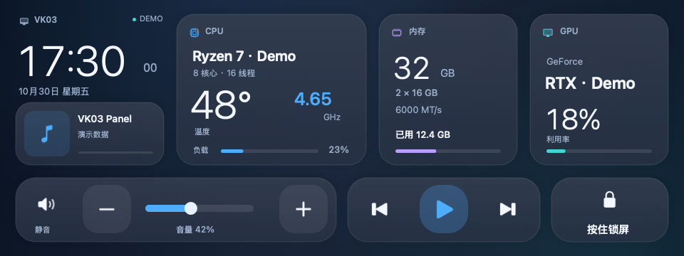

# VK03 Panel for macOS

[GitHub](https://github.com/Archibald-Lewis/vk03-panel-macos) · [Gitee](https://gitee.com/archibald-lewis/vk03-panel-macos) · [Companion project](https://github.com/Archibald-Lewis/stats-hackintosh-patches)

A native macOS monitoring and touch-control panel for the USB display in the VK03 PC case.

[中文](README.md) · [Build](docs/BUILD.md) · [Metrics format](docs/METRICS.md) · [Third-party notices](THIRD_PARTY_NOTICES.md)



See CPU temperature and frequency, memory use, GPU load and Now Playing information. Use the touchscreen for volume, mute, playback and a press-and-hold screen lock. The interface follows the system appearance and runs from the menu bar.

## Prebuilt app

[Download the DMG](https://github.com/Archibald-Lewis/vk03-panel-macos/releases/latest) · [Installation, signing and compatibility](docs/INSTALL.md)

AMD64 / x86_64 build, tested on an AMD Ryzen 7 9700X + RTX 5070 Hackintosh. Intel CPU machines are unverified. Ad-hoc signed and not notarized.


## Hardware and status

Tested on an AMD Ryzen 7 9700X (8 cores / 16 threads), GeForce RTX 5070, 32 GB RAM Hackintosh running macOS 26 Tahoe: display USB `345f:9132`, MS912C controller, `MCVKC03` panel, native `360 × 960` resolution, with touch device `374a:a401`. The verified installation uses 90° landscape orientation. Other touch orientations and Apple Silicon are unverified.

This app sends a monitoring dashboard to the display. It does not create an extended macOS desktop. Similar-looking displays may have different controllers; the app checks the chip, EDID and panel model before initializing.

## Build

Use macOS 26, Xcode or Command Line Tools with the macOS 26 SDK, Python 3, and libusb:

```bash
brew install libusb
bash build.sh
```

The output is `build/VK03 Panel.app`. The build creates the app and media helper from source without an installed app template. It does not install, launch or modify EFI. See [build details](docs/BUILD.md).

Hardware readings require the companion `stats-hackintosh-patches` package. Stock Stats does not export this feed. Missing or stale readings appear as dashes.

## Features

- Native Swift / AppKit dashboard with light and dark appearance.
- Hardware metrics exported by patched Stats, rather than a second sensor reader.
- Volume slider, mute, previous/next track, play/pause, and hold for 1.2 seconds to lock.
- Now Playing through MediaRemoteAdapter, with an Apple catalog artwork fallback.
- HID touch with a USB fallback, reconnect handling, and optional login startup.

## Limits and privacy

The UI is currently Chinese. Sensor coverage depends on Stats and the installed drivers. The artwork fallback can miss or return an incorrect match and does not repair the system's own Now Playing panel. MediaRemote is a private system interface and may change after an OS update.

A previous hardware build averaged approximately **1.6% of one CPU core and 118 MiB RSS**, including the media helper, in a 30-second background sample. Stats was excluded. This is a short measurement on one machine.

Metrics stay in the local user account. Artwork lookup sends artist and album names to Apple's search API and caches up to 32 matching images locally. The app has no telemetry server. [Local files and format](docs/METRICS.md)

The screenshots use synthetic values and are labeled `DEMO`. A Star helps other owners find the project. Hardware reports, touch-orientation fixes and English localization are welcome.

## Credits and license

The native panel code is MIT licensed. USB protocol research: [codehz/msdisplay](https://github.com/codehz/msdisplay). Metrics: [Stats](https://github.com/exelban/stats). Media integration: [MediaRemoteAdapter](https://github.com/ungive/mediaremote-adapter), BSD 3-Clause. USB library: [libusb](https://libusb.info/), LGPL-2.1-or-later. Third-party notices and licenses are preserved in this repository.
