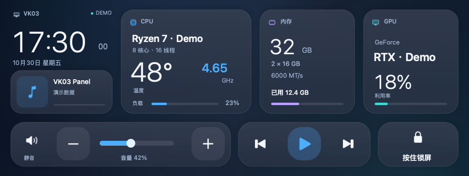
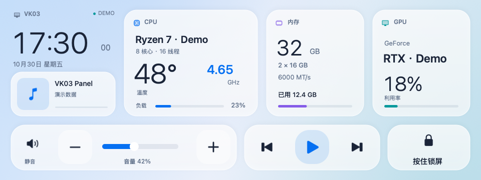

# VK03 Panel for macOS

[GitHub](https://github.com/Archibald-Lewis/vk03-panel-macos) · [Gitee](https://gitee.com/archibald-lewis/vk03-panel-macos) · [Companion project](https://github.com/Archibald-Lewis/stats-hackintosh-patches)

把 VK03 机箱上的 USB 小屏变成 macOS 监控与触控面板。

[English](README.en.md) · [构建说明](docs/BUILD.md) · [数据接口](docs/METRICS.md) · [来源与许可](THIRD_PARTY_NOTICES.md)



CPU 温度和频率、内存、GPU 负载、正在播放的音乐，再加上伸手就能点的音量和播放控制。界面跟随系统深浅色，关闭设置窗口后继续在菜单栏运行。

## 预编译安装

[下载 DMG 安装包](https://github.com/Archibald-Lewis/vk03-panel-macos/releases/latest) · [安装、签名与兼容性说明](docs/INSTALL.md)

提供 AMD64 / x86_64 版，实测 AMD Ryzen 7 9700X + RTX 5070 黑苹果，ad-hoc 签名、未经 Apple 公证。


## 已实现

- 原生 Swift / AppKit 应用，面向 macOS 26 Tahoe。
- 从定制 Stats 读取监控数据，不重复采集传感器。
- 触屏调节音量、静音、切歌、播放暂停；按住 1.2 秒锁屏。
- 系统 Now Playing 状态；系统封面缺失或全黑时，尝试从 Apple 曲库匹配。
- USB 断连自动重连，触控支持 HID 与 USB 直读两条路径。
- 方向设置，以及可关闭的登录自启。

## 支持范围

目前只在 AMD Ryzen 7 9700X（8 核 16 线程）+ GeForce RTX 5070 + 32 GB 内存的 macOS 26 黑苹果上实机验证。显示设备为 `345f:9132`，面板 `MCVKC03`，MS912C，原生分辨率 `360 × 960`，横向使用时为 `960 × 360`；触摸设备为 `374a:a401`。

这是一款监控面板。它不提供可拖入普通窗口的扩展桌面。相同外观的小屏可能使用不同控制器；程序会检查芯片、EDID 和面板型号，匹配失败时停止初始化。当前实测使用 90° 横向，其他安装方向的触控映射仍需实机验证。Apple Silicon 尚未验证。

## 从源码构建

需要 macOS 26、包含 macOS 26 SDK 的 Xcode 或 Command Line Tools、Python 3，以及 libusb：

```bash
brew install libusb
bash build.sh
```

产物为 `build/VK03 Panel.app`。构建脚本从源码生成应用、图标与播放器助手，不依赖预装应用模板。它只构建，不安装、不启动、不修改 EFI。[更多构建选项](docs/BUILD.md)

硬件监控需要另一个发布包 `stats-hackintosh-patches` 中的 Stats 数据导出补丁。普通版 Stats 尚不提供此接口；没有数据时读数显示为破折号。

## 使用

连接匹配的小屏后，打开应用，在菜单栏的显示器图标中选择“副屏设置”。当前实测方向为 90°。勾选“登录后自动启动”可启用自启，取消即可关闭。



上面两张图由程序渲染，标有 `DEMO`，所有数字和媒体信息均为演示数据。实体屏幕观感会受面板和拍摄条件影响。

## 资源与已知限制

此前实机版本在 30 秒后台采样中，主程序加播放器助手平均约占 **1.6% 单核 CPU、118 MiB 内存**，不含 Stats。它是一次短测，不能代表所有设备和长期运行结果。

界面目前为中文。监控项目取决于 Stats 和对应驱动实际提供的数据；不提供的传感器不会凭空补出。封面匹配可能找不到或匹配错误，也不会修复系统原生播放面板中的黑图。系统私有 MediaRemote 接口可能随 macOS 更新变化。

## 数据与网络

监控数据在本机用户目录交换。封面备用查询会向 Apple 搜索接口发送歌手和专辑名，并下载匹配图片；图片缓存在本机，最多 32 张。应用没有自己的遥测服务器。详情见[数据接口与本地文件](docs/METRICS.md)。

## 反馈和贡献

遇到问题时，请提供 macOS 版本、CPU 架构、显示与触摸设备的 VID/PID，以及具体表现。请勿上传完整 EFI、设备序列号、账户数据或未经清理的系统日志。

欢迎补充其他同控制器面板的测试、触控方向适配和英文界面。有用的话，欢迎点个 Star，让更多同款机箱用户找到它。

## 致谢与许可

原生面板代码采用 MIT 许可。感谢 [codehz/msdisplay](https://github.com/codehz/msdisplay) 的 USB 协议研究、[exelban/Stats](https://github.com/exelban/stats)、[MediaRemoteAdapter](https://github.com/ungive/mediaremote-adapter) 和 [libusb](https://libusb.info/)。各第三方组件保留原作者与许可证，详见 [THIRD_PARTY_NOTICES.md](THIRD_PARTY_NOTICES.md)。
