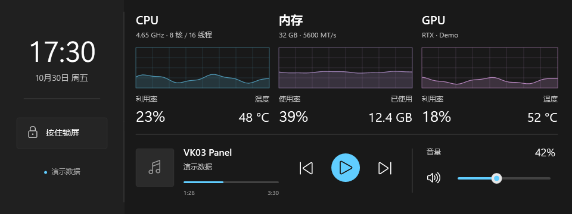

# VK03 Panel for Windows

Turns the VK03 case's USB secondary screen (MS912C / `MCVKC03`, 360×960) into a Windows 11
monitoring and touch panel: CPU temperature and clock, memory, GPU, now-playing media, plus
touch volume and playback controls.

This is the Windows implementation in [VK03 Panel](https://github.com/Archibald-Lewis/vk03-panel)
that also merges both visual languages into one app: the panel theme can be switched between
**macOS (original)** and **Windows 11 (Fluent)** at any time.



## Features

- Native .NET 9 / WPF application; the settings window follows Windows 11 design
  (Mica ambiance, 8 px cards, Segoe UI Variable, Fluent toggles, system light/dark and accent).
- Two panel themes, switchable live from the Appearance page.
- Local monitoring only: CPU load/frequency, memory, NVIDIA GPU utilisation and temperature.
- Now playing via the Windows media session (GSMTC), including artwork and progress.
- Touch: mute, volume scrub, transport, hold-to-lock (HID and raw-USB backends).
- Auto reconnect, run at login, tray-only operation, single instance, orientation 0/90/180/270.
- Monitoring and touch work without administrator rights. AMD Ryzen Master SDK temperature readings require elevation.

## Data sources and limitations

CPU temperature is read from the AMD Ryzen Master SDK when available (administrator rights required), with HWiNFO shared memory and LibreHardwareMonitor WMI as fallbacks. Missing readings appear as `—`.

The touch controller currently reports problem code 10 on some Windows installations. The app
probes both HID and libusb0 backends, shows diagnostics, and keeps the panel usable without touch
(the preview supports mouse input). Idle USB timeouts keep the touch handle open so subsequent presses and releases are received without a reconnect gap.

The Windows theme uses Task Manager-style CPU, memory and GPU graphs, a clock sidebar, and media / volume controls. Both light and dark themes are supported.

## Build

Requires Windows 11, .NET 9 SDK and PowerShell 7:

```powershell
.\build.ps1
```

The script generates the icon, builds, renders demo images, runs unit tests and publishes a
self-contained build to `dist/VK03Panel/`. See [docs/BUILD.md](docs/BUILD.md).

## Command line

```text
VK03Panel.exe --background             start in the tray
VK03Panel.exe --self-test [--frame]    device / driver / chip / EDID self-test
VK03Panel.exe --demo <png> [--theme mac|win11] [--dark|--light]
VK03Panel.exe --render <png>           render current machine data
VK03Panel.exe --diagnose               print a full diagnostic summary
```

## License

MIT. Protocol research by [codehz/msdisplay](https://github.com/codehz/msdisplay); original macOS
application by [vk03-panel-macos](https://gitee.com/archibald-lewis/vk03-panel-macos).
See [THIRD_PARTY_NOTICES.md](THIRD_PARTY_NOTICES.md).
