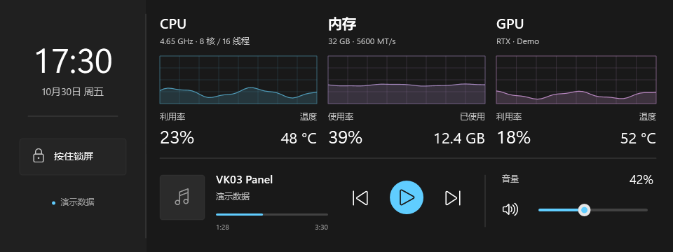
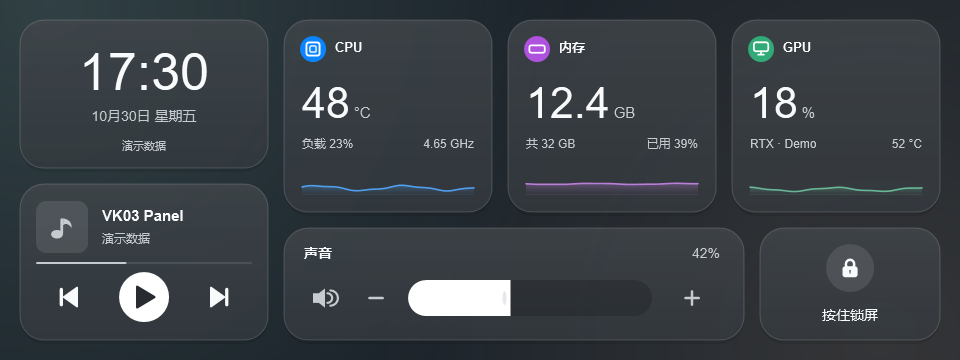
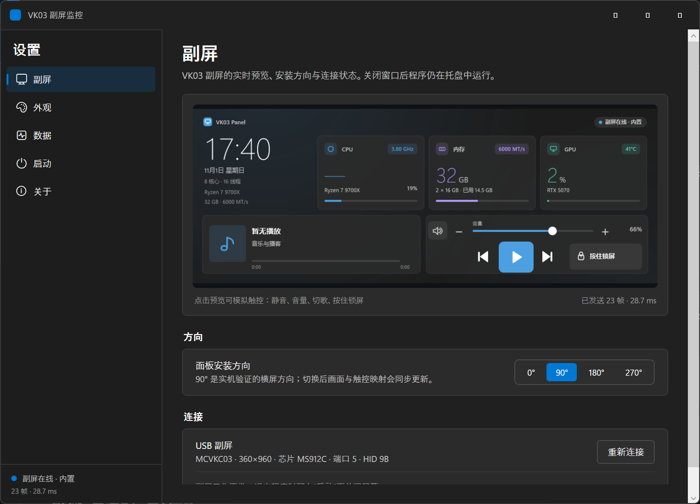
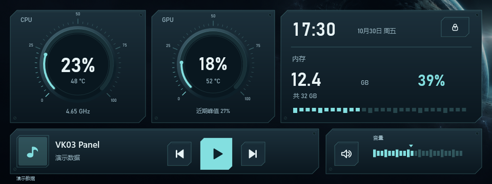
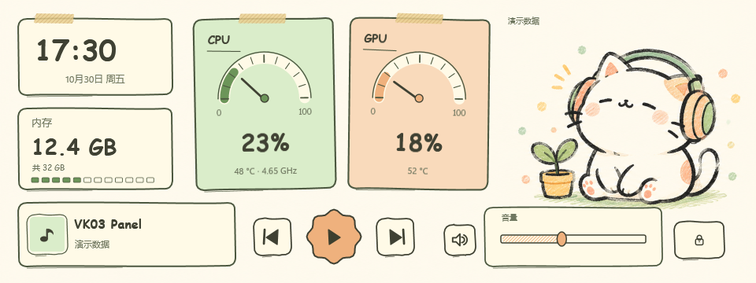
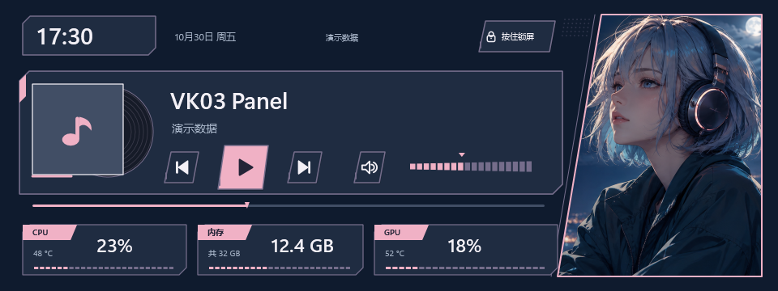
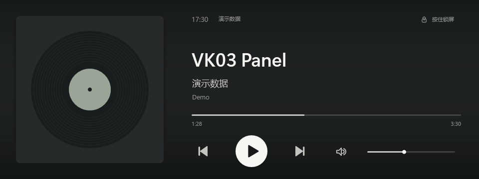

# VK03 Panel for Windows

把 VK03 机箱上的 USB 小屏（MS912C / `MCVKC03`，360×960）变成 Windows 11 的监控与触控面板：
CPU 温度与频率、内存、GPU、正在播放的音乐，再加上随手可点的音量与播放控制。

本目录是 [VK03 Panel](https://github.com/Archibald-Lewis/vk03-panel) 的 Windows 版，macOS 源码保留在仓库根目录，
并把 **macOS 原版观感** 与全新的 **Windows 11 Fluent 观感** 合并进同一个程序：副屏主题可随时切换。





## 功能

- 原生 .NET 9 / WPF 应用，设置窗口采用 Windows 11 设计：Mica 氛围、8px 圆角卡片、
  Segoe UI Variable、Fluent 开关与分段控件，跟随系统深浅色与强调色。
- **六款副屏主题**，在「外观」页即时切换：
  - `Windows 11`：参考任务管理器性能页，提供 CPU / 内存 / GPU 网格趋势图、实时指标，以及媒体与音量触控条。
  - `macOS`：参考控制中心的中性半透明模块、胶囊音量滑条与填充播放图标。
  - `星环`：CPU / GPU 精密双仪表、内存分段刻度、金属表圈、实体媒体按键与分段音量控制。
  - `沉浸播放`：大封面、柔化的封面背景、两行曲名、中性色播放控件与可点击进度条。
  - `手绘卡通`：卡通指针表、胶带便签、花形播放键、贴纸切歌键与铅笔填充音量条，搭配原创耳机猫咪。
  - `二次元`：漫画斜切播放器、唱片封套、平行四边形按键、数据标签与独立角色画框。
- 监控数据全部在本机采集：CPU 负载 / 频率、内存用量与内存条信息、NVIDIA GPU 利用率与温度。
- CPU 温度直接读取 **AMD Ryzen Master SDK** 的处理器传感器；HWiNFO 共享内存与
  LibreHardwareMonitor 作为回退。
- 正在播放：标题、歌手、封面、进度；上一首 / 播放暂停 / 下一首。
- 触控：静音、音量拖动、切歌、按住 1.2 秒锁屏（HID 与 USB 直读双后端）。
- USB 自动重连、开机自启、托盘常驻、单实例、方向设置（0/90/180/270）。
- 主题仅通过电脑设置“外观”页或托盘菜单直接选择。副屏没有主题按钮，时钟也没有隐藏的切换热区。
- 在“播放”页设置网易云歌单：有媒体会话时优先暂停/继续；空闲时启动歌单。仅保存歌单 ID，不需要账号密码。
- 沉浸播放的进度条支持点按跳转，前提是当前播放器通过 Windows 媒体会话开放跳转能力。
- 普通监控与触屏无需管理员权限；AMD Ryzen Master SDK 温度读取需要管理员权限。



## 数据来源与限制

| 数据 | 来源 |
|---|---|
| CPU 负载 | `GetSystemTimes` 差分 |
| CPU 频率 | `CallNtPowerInformation(ProcessorInformation)` 平均当前主频 |
| 内存 | `GlobalMemoryStatusEx` + WMI `Win32_PhysicalMemory`（条数 / 速率） |
| GPU | NVML（NVIDIA 驱动自带）；名称回退 WMI |
| 媒体 | Windows GSMTC（系统「正在播放」） |
| 音量 | Core Audio 默认输出端点 |
| 锁屏 | `LockWorkStation` |
| **CPU 温度** | 优先 **AMD Ryzen Master SDK**（GetRmCpuParameters，需要管理员）；回退 HWiNFO 共享内存 / LibreHardwareMonitor WMI |
| **GPU 温度 / 利用率** | NVML（NVIDIA 驱动自带，无需管理员） |

Windows 11 的**内存完整性（HVCI）**会阻止 WinRing0 类传感器驱动，因此本程序不在进程内读取传感器，
这与原版 macOS 版「依赖 Stats 提供数据」的设计一致。没有温度来源时，面板与设置页显示 `—`，不会伪造数据。

触屏在部分 Windows 环境下会出现问题代码 10（`CM_PROB_FAILED_START`）；程序会自动探测 HID 与
libusb0 两种后端，并在设置页给出诊断。触屏不可用时，副屏与鼠标模拟触控仍可正常使用。USB 直读将空闲读取超时视为正常等待，保持连接；只有真实读写错误才重新连接。

## 快速开始

### 使用发布包

1. 解压 `dist/VK03Panel/` 到任意目录（建议固定位置）。
2. 确认副屏已连接，且**厂商程序（如 Myth.Cool）未在运行**（同一接口不能同时被占用）。
3. 运行 `VK03Panel.exe`，在「外观」选择主题、在「副屏」确认连接。
4. 需要开机自启时，在「启动」页打开「开机自动启动」。

前置条件：副屏视频接口（`VID_345F&PID_9132` 的 MI_03）需要 libusb-win32 驱动。
该驱动随厂商程序安装；如果设备管理器里显示 `MS USB Display` 且工作正常，就无需额外操作。

### 从源码构建

需要 Windows 11、[.NET 9 SDK](https://dotnet.microsoft.com/) 与 PowerShell 7：

```powershell
.\build.ps1
```

脚本会生成图标、编译、渲染演示图、运行单元测试，并输出自包含版本到 `dist/VK03Panel/`。
更多参数见 [构建说明](docs/BUILD.md)。

## 命令行

```text
VK03Panel.exe                      打开设置窗口
VK03Panel.exe --background         启动后只保留托盘图标（自启使用）
VK03Panel.exe --self-test [--frame] [--hold 秒] [--rotation 0|90|180|270]
                                   设备/驱动/芯片/EDID 自检；--frame 实际点亮副屏
VK03Panel.exe --demo <png> [--theme mac|win11|nebula|immersive|sketch|anime] [--dark|--light]
                                   用合成数据出图（不碰硬件）
VK03Panel.exe --render <png>      用本机真实数据出图
VK03Panel.exe --diagnose          输出设备、传感器、媒体与音频诊断
```

`--demo`、`--render` 与 `--diagnose` 不需要占用副屏；`--self-test --frame` 会实际写入画面。

## 目录结构

```text
src/VK03Panel.Core/       传输、渲染、主题、指标、媒体、音频、触控、配置
src/VK03Panel.App/        WPF 应用：托盘、设置窗口、工作线程
src/VK03Panel.Cli/        命令行工具
src/VK03Panel.Core.Tests/ 单元测试
tools/VK03Panel.IconGen/  多分辨率图标生成
docs/                     构建、安装、数据接口与主题说明
assets/                   演示图、设置窗口截图与图标
```

## 已知限制

- 实机验证方向为 90°（横屏）。0°/180°/270° 的触控映射沿用原版算法，仍属实验性。
- 目前只支持 MS912C / `MCVKC03` / 360×960 / 视频端口 5 或 6；不匹配的面板会在初始化前被拒绝。
- GPU 遥测目前覆盖 NVIDIA（NVML）；AMD / Intel 显卡只显示名称。
- 应用向副屏发送监控画面，不会把桌面扩展到副屏。常规运行不修改驱动或固件；手动点击触屏修复会重启设备，必要时移除并重新扫描设备。

## 许可与致谢

本项目代码采用 MIT 许可。USB 协议研究来自 [codehz/msdisplay](https://github.com/codehz/msdisplay)，
原始 macOS 版本为 [vk03-panel-macos](https://gitee.com/archibald-lewis/vk03-panel-macos)，
运行时依赖 libusb-win32 驱动与 Windows 自带的 NVML。详情见 [THIRD_PARTY_NOTICES.md](THIRD_PARTY_NOTICES.md)。

## 新主题预览

以下均为合成演示数据。









歌单启动使用本机已安装的网易云客户端；登录状态和歌曲权限由客户端负责。客户端接口可能随版本变化，当前启动命令按本机 3.1 客户端资源验证。
